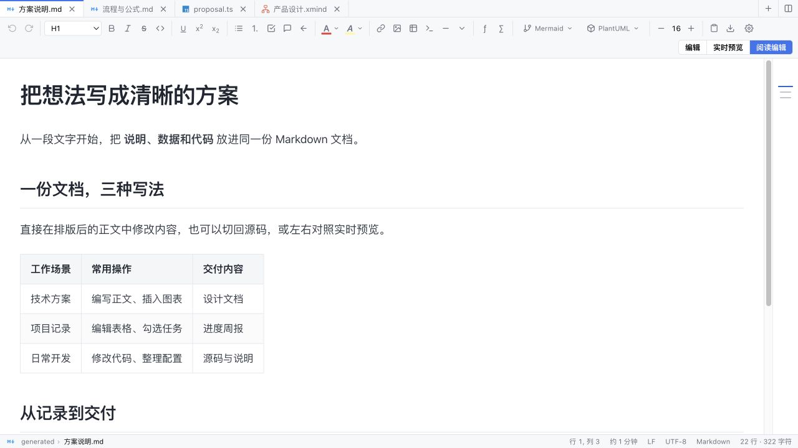
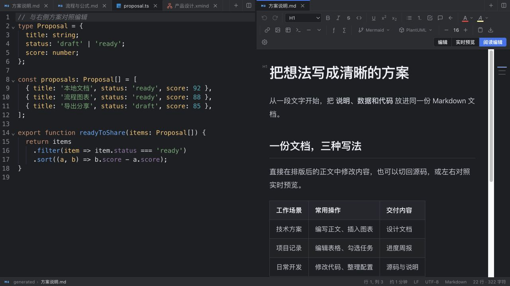
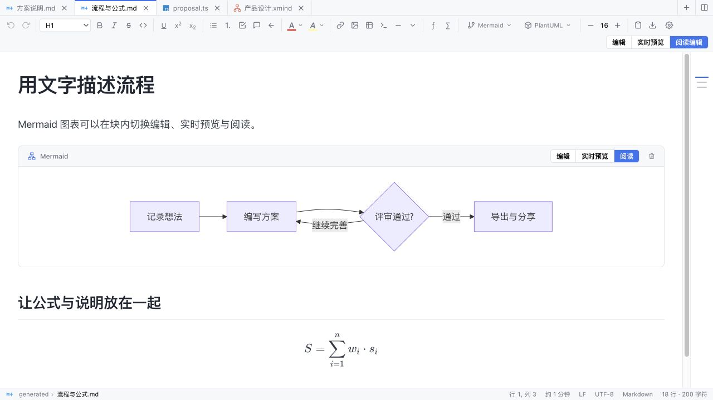

# DEditor

**让 Markdown、代码与 XMind 导图共用一个工作区。**

DEditor 是面向 macOS 和 Windows 的本地编辑器。在排版后的 Markdown 正文中直接写作，随时切换源码与实时预览；把实现文件和 `.xmind` 导图放在旁边对照。内容保存为本地文件。



## 核心体验

### Markdown：成稿、源码、预览共享一份原文

阅读编辑可以直接修改正文和表格；Mermaid、PlantUML、公式在文档中呈现，图表块可就地切换编辑与预览。需要控制 Markdown 语法时切回源码，三种视图共用文档内容与撤销历史。

### 代码：与文档同屏，直接修改

左右分屏各有独立标签和滚动位置，可打开不同文件、同一文件的双视图，或对照文件差异。代码编辑支持多光标、折叠、跨文件搜索替换，以及 JSON、SQL 格式化。



### XMind：直接编辑原文件

打开 `.xmind`，修改主题、层级、联系和样式，再保存回 XMind 文件。导图可与方案、代码并排核对。

## 与常用工具的差别

| 产品 | 设计重心 | DEditor 的工作方式 |
| --- | --- | --- |
| [Typora](https://typora.io/) | Markdown 的即时排版写作 | 在阅读编辑之外，提供源码与实时双栏视图；代码和 `.xmind` 也能在同一窗口处理 |
| [VS Code](https://code.visualstudio.com/docs/languages/markdown) | 代码编辑，以及 Markdown 源码与同步预览 | 排版后的 Markdown 正文可直接编辑，并可打开、保存 `.xmind` |
| [Xmind](https://xmind.app/features/) | 导图结构、样式与演示 | 编辑 `.xmind` 的同时，将 Markdown 和代码并排对照 |

<details>
<summary>查看图表与导图界面</summary>




</details>

## 文件与交付

草稿恢复、历史版本和可选自动保存围绕本地文件工作。Markdown 可导出 HTML、PDF、DOCX、PPTX，图表可导出 SVG。核心编辑可离线使用；PlantUML、远程图片和图床需要网络。

## macOS 未公证版本安装

以下以 1.0.3 Apple Silicon 安装包为例；其它版本或架构请使用实际下载的 DMG 文件名。

1. 安装前，在 DMG 所在目录打开终端，执行 `xattr -cr DEditor_1.0.3_aarch64.dmg`。
2. 打开 DMG，将 `DEditor.app` 拖入“应用程序”（`/Applications`）。
3. 安装后，执行 `xattr -cr /Applications/DEditor.app`，再启动应用。

## 本地构建

需要 Node.js 22 或 24、npm、Rust stable。macOS 另需 Xcode Command Line Tools；Windows 另需 Microsoft C++ Build Tools 与 WebView2。

```sh
npm install
```

|  | macOS | Windows PowerShell |
| --- | --- | --- |
| 启动开发版 | `./scripts/start.sh` | `.\scripts\start.ps1` |
| 构建安装包 | `./scripts/build-mac.sh` | `.\scripts\build-win.ps1` |

[开发文档](docs/development.md) · [当前待办](docs/pending-tasks.md)

项目尚未声明独立开源许可证；第三方资源遵循各自的授权说明。
